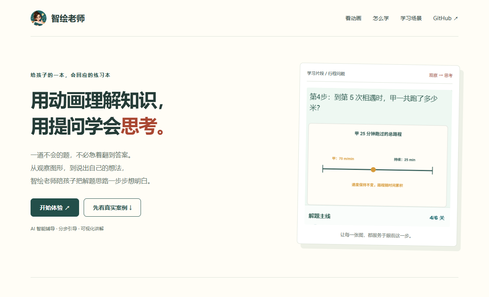
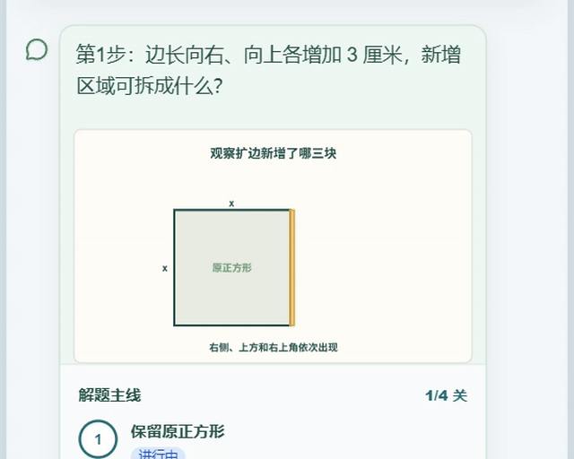

# Zhihui Teacher · 智绘老师

**Start with a math problem. Understand through visuals. Think through guided questions.**

[Try the product](https://exam.thinkmoon.cn/) · [Live marketing site](https://thinkmoon.github.io/zhihui-teacher/) · [中文介绍](README.md)



Zhihui Teacher is a Chinese-language AI math tutoring product for primary-school learners. It combines photo-based problem input, step-by-step questions, visual explanations and learning summaries.

- **Guided reasoning:** students respond to questions and hints as they work through a solution.
- **Visual math:** diagrams and animations help explain relationships involving fractions, areas, distances and other quantities.
- **Review:** students can revisit learning summaries and records.

[](https://exam.thinkmoon.cn/)

The recordings show specific existing examples. Prebuilt examples and explanations generated for uploaded problems are distinct experiences. Animation availability varies; recognition and explanations can contain errors.

## Repository scope

This repository contains the public **marketing website**, screenshots and demonstration recordings. It does **not** contain the tutoring backend, model configuration, accounts or student data. Visit **https://exam.thinkmoon.cn/** to use the complete product.

## Preview locally

Open `index.html` directly, or run this command with an existing Python 3 installation:

```bash
python -m http.server 8080 --bind 127.0.0.1
```

Then visit `http://127.0.0.1:8080`. No dependencies, build step or API keys are required.

## GitHub Pages

The `main` branch root is automatically published at **https://thinkmoon.github.io/zhihui-teacher/**. `.nojekyll` enables plain static publishing. Media is available under `/zhihui-teacher/assets/`, for example [the area animation](https://thinkmoon.github.io/zhihui-teacher/assets/area-growth.mp4).

The official product website and canonical URL remain **https://exam.thinkmoon.cn/**. Publishing this repository does not change that website or its application. The project-level `robots.txt` does not control crawling for the entire `thinkmoon.github.io` domain.

## Contributions and licensing

See [CONTRIBUTING.md](CONTRIBUTING.md). Please do not include personal student information in public issues.

The marketing website code is released under the [MIT License](LICENSE). Product branding and media have separate terms described in [NOTICE.md](NOTICE.md).
