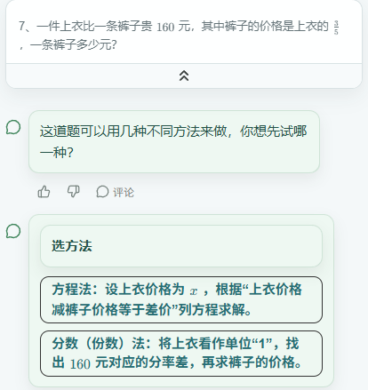
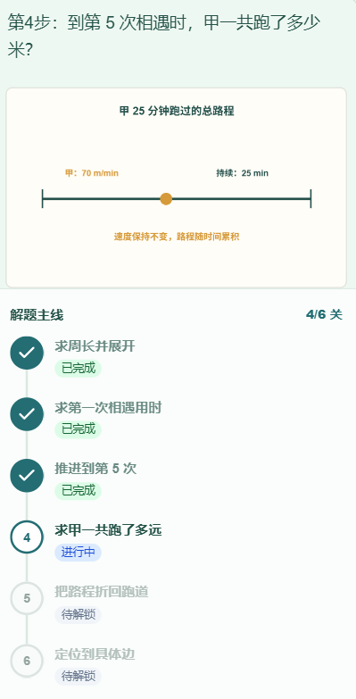

<p align="center"></p>

<div align="center">

# 智绘老师 · Zhihui Teacher

**拍题开始，动画帮助理解，提问带着思考。**

智绘老师是一款 AI 智能辅导产品，通过分步提问与可视化讲解，陪伴学习者理解问题、理清思路。

[立即体验](https://exam.thinkmoon.cn/static/#/login) · [在线宣传页](https://thinkmoon.github.io/zhihui-teacher/) · [动画与截图](#动画与截图) · [本地预览](#本地预览) · [English](README.en.md)


[](LICENSE)

</div>


## 让抽象的知识看得见

遇到不会的题，孩子需要的不只是一个答案，还需要理解「为什么这样想」。智绘老师围绕当前题目组织解题步骤，用提问帮助孩子表达思路，在适合的步骤用图形和动画呈现数量关系，最后整理学习小结。

| 学习环节 | 产品如何帮助 |
| --- | --- |
| 拍照开始 | 上传题目图片，识别并选择需要辅导的题目 |
| 选择方法 | 在存在多种可行解法时，选择更容易理解的思路 |
| 分步引导 | 通过问题、选项与提示推进，不一开始就把完整答案摆出来 |
| 数形结合 | 用线段、面积、分数等视觉模型辅助理解当前步骤 |
| 回顾整理 | 完成后查看学习小结，也可以从学习记录继续复习 |

## 动画与截图

### 面积变化：把增加的部分画出来

[](https://exam.thinkmoon.cn/static/#/login)

上图为产品现有案例录屏片段。点击图片进入产品登录页，或查看 [MP4 原始演示](assets/area-growth.mp4)。

### 从选方法到理解数量关系

<table>
  <tr>
    <th>选择适合自己的解法</th>
    <th>看图理解，再沿步骤推进</th>
  </tr>
  <tr>
    <td></td>
    <td></td>
  </tr>
</table>

更多真实案例录屏：[分步提问](assets/detailed-guidance.mp4) · [追及与相遇](assets/chase-meeting.mp4) · [水池进出水](assets/pool-visual.mp4) · [选错后的提示](assets/wrong-answer-branch.mp4)。

这些素材展示的是具体案例，不代表每道上传题目都会产生同样的动画。预置案例与拍题后生成的讲解是不同入口；动画形式取决于题目、步骤及生成结果。

## 开始体验

1. 打开 **[产品登录页](https://exam.thinkmoon.cn/static/#/login)**，进入产品并登录或注册。
2. 上传题目，或选择产品内提供的经典案例。
3. 阅读问题、观察图形、尝试作答，再跟随提示继续。
4. 完成后回顾解题过程和学习小结。

适合希望理解问题、理清解题思路的学习者，以及提供学习陪伴的家长。AI 识题和讲解可能出现错误，关键结论应结合题目与老师的解释核对；本项目不承诺成绩提升或所有题型覆盖。

## 这个仓库开源什么

这是智绘老师的**独立宣传站与公开演示素材仓库**，包含静态 HTML/CSS、产品介绍、截图与案例录屏。完整辅导应用、后端服务、模型配置和学生数据不在本仓库中。

- 正式官网始终是 **https://exam.thinkmoon.cn/**。
- 本地页面的体验按钮跳转至现有线上产品，不需要部署后端。
- GitHub Pages 自动发布本仓库的静态宣传页与资源，不修改正式官网或应用。
- 页面正文直接包含在 HTML 中，无需 JavaScript 渲染，无第三方字体或运行时依赖。

## 在线宣传页与静态资源

访问 **https://thinkmoon.github.io/zhihui-teacher/**。GitHub Pages 从 `main` 分支根目录发布，推送后由 GitHub 自动更新；`.nojekyll` 使静态文件直接发布，无需 Jekyll 构建。

静态资源可以通过 HTTPS 直接引用，例如：

- 截图：`https://thinkmoon.github.io/zhihui-teacher/assets/overview.png`
- 动图：`https://thinkmoon.github.io/zhihui-teacher/assets/area-demo.gif`
- 视频：`https://thinkmoon.github.io/zhihui-teacher/assets/area-growth.mp4`

页面内部使用相对资源路径，适配 `/zhihui-teacher/` 子路径。正式官网与 canonical 仍指向 `https://exam.thinkmoon.cn/`，体验按钮指向 `https://exam.thinkmoon.cn/static/#/login`，不绑定新的自定义域名。项目目录内的 `robots.txt` 不能控制整个 `thinkmoon.github.io` 域名的抓取规则；抓取规则以该域名根路径为准。

现有官网尚未改为引用这些资源；如需引用，使用上述完整地址。更新同名资源后可能存在缓存，重要版本可使用新文件名。

## 本地预览

直接用浏览器打开 `index.html` 即可。也可以使用已有 Python 3 启动静态预览：

```bash
git clone https://github.com/thinkmoon/zhihui-teacher.git
cd zhihui-teacher
python -m http.server 8080 --bind 127.0.0.1
```

浏览器访问 `http://127.0.0.1:8080`。无需安装依赖、无需 API Key，也不需要构建。

```text
index.html       宣传页正文、分享信息与结构化数据
styles.css       响应式布局与练习本视觉样式
assets/          已公开的截图、动画与录屏
robots.txt       抓取规则，指向正式官网 sitemap
sitemap.xml      正式宣传页地址
README.en.md     English introduction
CONTRIBUTING.md  贡献、验证与内容边界
NOTICE.md        素材来源与品牌使用说明
LICENSE          宣传站代码的 MIT 许可证
```

## 常见问题

**这是直接给答案的拍照搜题吗？** 主要体验是分步提问和提示，帮助学生理解过程；完成后可以回顾完整解题小结。

**所有题目都有动画吗？** 不保证。可视化服务于适合表达的知识与关系，具体形式与覆盖范围以实际体验为准。

**可以下载这个仓库部署完整辅导系统吗？** 不可以，本仓库只包含宣传站。完整产品请通过官网体验。

**开源宣传站能保证搜索引擎收录吗？** 不能。公开仓库提供额外的发现和访问入口，收录与排名仍由搜索引擎决定。

## 参与与反馈

欢迎通过 [Issues](https://github.com/thinkmoon/zhihui-teacher/issues) 反馈宣传页错误、可访问性问题或提出改进建议。提交前请阅读 [贡献说明](CONTRIBUTING.md)，不要公开学生姓名、账号、题图中的个人信息或登录凭据。

宣传站代码采用 [MIT](LICENSE)；品牌、截图和录屏的使用范围见 [NOTICE.md](NOTICE.md)。

---

**从观察图形，到自己作答。** → [前往智绘老师](https://exam.thinkmoon.cn/static/#/login)
